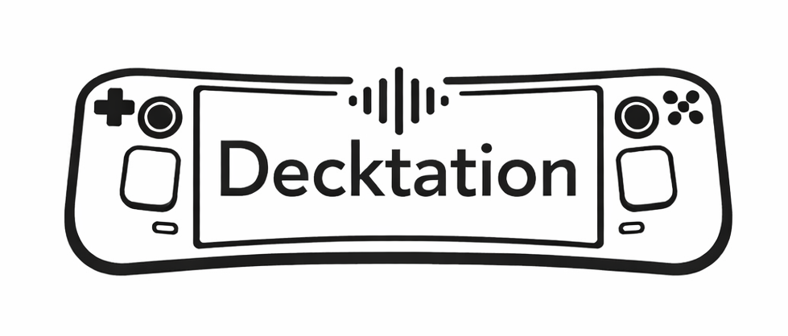

<p align="center">
  
</p>

# Decktation — Push-to-Talk Dictation for Steam Deck

[](https://github.com/silverfoxy/decktation/actions/workflows/build.yml?query=branch%3Amaster)
[](https://github.com/silverfoxy/decktation/actions/workflows/integration.yml?query=branch%3Amaster)

Speak naturally and Decktation transcribes your words locally, then types them into the active game or app. Use it for game chat, messages, searches, and other text fields.

- Hold a configurable controller button combination to record; **L1 + R1** is the default.
- Choose a preset for World of Warcraft, Guild Wars 2, or generic text entry.
- Speak a channel prefix such as “party” to route game chat.
- Say “command gg” or “command ready” to enter `/gg` or `/ready` without a chat-channel prefix.
- Adjust the Whisper model and transcription language in the plugin.
- Enable **Spoken punctuation** in Advanced settings to turn English commands such as “comma” and “question mark” into symbols.
- The optional WoW context addon can provide saved game context, but its updates are not reliably live; see [upstream issue #13](https://github.com/silverfoxy/decktation/issues/13).

## Install Decktation

Decktation requires Decky Loader. If you haven’t installed it yet, follow the [official Decky Loader installation instructions](https://github.com/SteamDeckHomebrew/decky-loader#installation) and get the installer from [decky.xyz](https://decky.xyz/), then return here.

Install Decktation from the packaged release below. Future stable releases are available through Decktation’s built-in updater.

### Recommended: Install from URL

1. Open **Decky Settings** and enable developer options if needed.
2. Choose **Install Plugin from URL**.
3. Paste this URL and install Decktation:

   ```text
   https://decktation.com/Decktation.zip
   ```

Decktation checks for stable updates automatically when you open the plugin. See [Updating Decktation](#updating-decktation) for the in-plugin update flow.

### Alternative: Install from a packaged ZIP

Download the [latest packaged Decktation ZIP](https://decktation.com/Decktation.zip), then choose **Install Plugin from ZIP** in Decky Settings.

> **Do not install GitHub’s automatically generated “Source code (zip)” or “Source code (tar.gz)” archives.** They are not Decktation plugin packages and do not include its bundled dependencies.

### Updating Decktation

Decktation has a built-in updater that checks for newer stable releases when you open the plugin. When an update is available, open the update notice, select **Update to [version]**, and confirm Decky’s installation prompt.

You can also check manually through **Advanced settings → Check for updates**. Finish any recording, transcription, or pending draft before installing an update. Updates preserve your saved settings and downloaded Whisper models.

If you are running an older version without the updater, or the in-plugin installer is unavailable, reinstall the [latest packaged ZIP](https://decktation.com/Decktation.zip) through Decky’s **Install Plugin from URL** or **Install Plugin from ZIP**. See the [installation and update guide](doc/INSTALLATION.md#updating-decktation).

## Quick start

1. Open the Steam Deck **Quick Access Menu** (`...`) and open **Decktation**.
2. Under **Mode**, choose **WoW**, **WoW Forever**, **GW2**, or **Generic**. Use **Mode → Edit game profile** to customize channel commands, spoken triggers, recognition keywords, and the chat submission input. WoW Forever submits with controller A by default; regular WoW uses Enter.
3. Turn **Enable** on and wait for the status to show **Ready**. The first use of a model may need an internet connection to download it.
4. Select **Test Dictation (3s)**, speak, and check the **Result** in the panel. The test displays the transcript without typing it into the active app.
5. Focus the game or text field. Hold **L1 + R1**, speak, then release to transcribe and enter the text. Use **Change binding** on the main page to choose another button combination.

Under **Advanced settings → Sending → Text insertion**, choose **Paste** or **Type (only English keyboard)**. Type requires an English (US) keyboard layout and ASCII text. Under **Transcription sending**, choose immediate sending, review before sending, or a countdown. See [advanced configuration](doc/ADVANCED_CONFIGURATION.md) for the sending options and [typing research](doc/gamescope-typing-research.md) for the Gamescope work.

WoW and GW2 presets normally open game chat, add the selected channel command, and send the message; the spoken **type** channel enters text without opening chat. **Generic** also enters text directly in the focused field. See [channel and preset configuration](doc/ADVANCED_CONFIGURATION.md) for details.

If your microphone crackles or transcription is poor, see [microphone troubleshooting](doc/TROUBLESHOOTING.md#microphone-crackles-pops-or-cuts-out) for Steam Voice settings to try, including a workaround reported by a Steam Deck LCD user.

## Documentation

- [Advanced configuration](doc/ADVANCED_CONFIGURATION.md): presets, spoken channel prefixes, model and language settings, and controller mappings.
- [Troubleshooting](doc/TROUBLESHOOTING.md): plugin logs, recording, controller input, and text entry.
- [WoW context guide](doc/WOW_INTEGRATION.md): setup, the current SavedVariables limitation ([issue #13](https://github.com/silverfoxy/decktation/issues/13)), and the proposed real-time companion ([issue #36](https://github.com/silverfoxy/decktation/issues/36)).
- [Development](doc/DEVELOPMENT.md): build, test, and architecture notes.
- [Privacy and permissions](doc/PRIVACY_AND_PERMISSIONS.md): diagnostic data, local processing, and Decky’s `_root` permission.
- [Installation guide](doc/INSTALLATION.md): stable release links, branch builds, and development artifacts.

## Community

Join the [Decktation Discord community](https://discord.gg/yhcCd6rrR) to ask questions, share feedback, and discuss game profiles. Please report bugs and feature requests through [GitHub Issues](https://github.com/silverfoxy/decktation/issues) so they can be tracked.

## Privacy

Audio, transcripts, and WoW context are processed locally and are not uploaded. Whisper model files are downloaded from Hugging Face on first use. Optional **Diagnostics → Share** is off by default; when enabled, Decktation sends scrubbed errors, usage counts, and performance metrics to Sentry. See [privacy and permissions](doc/PRIVACY_AND_PERMISSIONS.md) for what diagnostics include.

The separate **Diagnostics → Controller input debugger** collects a bounded local 30-second input report. Review it before explicitly sending that single report to Sentry; it does not enable ongoing diagnostics sharing.

## Permissions

Decktation uses Decky’s `_root` permission to read controller inputs and type the transcript through its bundled keyboard helper. Dictated text is passed as data, never run as a command. Read the [permissions details](doc/PRIVACY_AND_PERMISSIONS.md).

## Credits and license

Built with [whisper.cpp](https://github.com/ggml-org/whisper.cpp) and [Decky Loader](https://github.com/SteamDeckHomebrew/decky-loader). Decktation is licensed under the MIT License.

Website hosting and domain setup: [decktation.com setup](doc/DOMAIN_SETUP.md).
